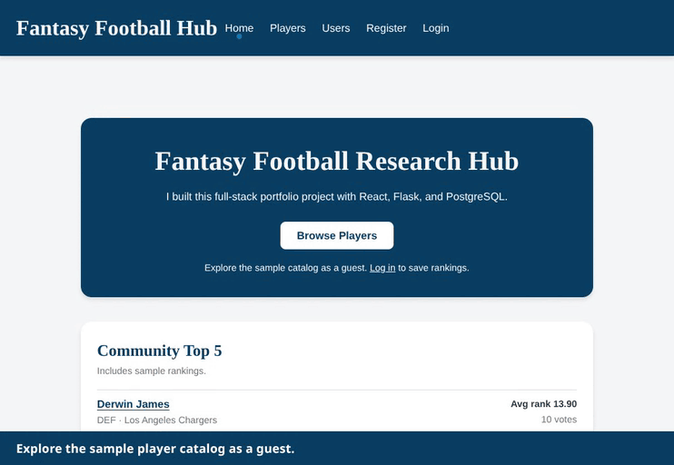

# Fantasy Football Research Hub

**[Live Demo](https://fantasy-football-research-hub.onrender.com)** · [45-second walkthrough](#demo-walkthrough)

## Overview

Fantasy Football Research Hub (FFRH) is a full-stack portfolio project for researching players with sample stats and building a personal ranking board.

## Demo walkthrough

Browse the player catalog as a guest, open a player, and sign in to return to their profile. Save a ranking and reload the page to see the saved rank again. The recording uses a local database with sample data.



Open **Browse Players** to search by name and combine position and team filters. Select **Compare Players** to view two players at the same position side by side. Sign in to save a rank, then open **My Rankings** on your profile to see it alongside the community average.

## Local demo

These commands were tested with Python 3.12 and Node.js 24. Use a Bash shell on Linux, macOS, or WSL. If you already have a `.env`, verify that `DATABASE_URI` points to a local SQLite file before migrating.

```bash
git clone https://github.com/Jwmarsh16/fantasy-football-research-project.git
cd fantasy-football-research-project
python3 -m venv .venv
source .venv/bin/activate
python -m pip install -r requirements.txt
npm ci --prefix client
test -f .env || cp .env.example .env
(cd server && python -m flask --app app db upgrade && python seed.py)
honcho start -f Procfile.dev
```

Open [http://127.0.0.1:5173](http://127.0.0.1:5173). Vite forwards `/api` requests to Gunicorn on port 5555.

1. Select **Browse Players**, search or filter the catalog, and open a player profile. Use **Compare Players** to compare two players at the same position.
2. Select **Log in** on the player profile and use `demo@example.test` with `FfrhLocalDemo123!`.
3. The app returns you to the player profile. Save a rank, open **My Rankings** on your profile, and reload to confirm it appears there.

The seed command adds 35 players with sample statistics plus fixture reviews and rankings. It requires a migrated file-based SQLite database and `FFRH_LOCAL_DEMO=true`. It skips a database it has already seeded and refuses to seed a database containing other app data. The default database is `server/instance/ffrh-local.db`.

### Verification

Run these from the repository root with the virtual environment active.

```bash
npm run lint --prefix client
npm run test --prefix client
npm run build --prefix client
(cd server && python -m unittest discover -s tests -v)
```

The browser test starts its own Flask server on port 5055 and creates a temporary SQLite database.

```bash
(cd client && npx playwright install chromium && npm run test:e2e)
```

## Features

- **Player Rankings:**  
  Users can save or update one rank per player, with the option to post a separate review. **My Rankings** lists every saved rank alongside the community average and links to the player profile for edits.

- **User Reviews:**  
  Registered users can write reviews for NFL players, providing personal insights and opinions. Reviews are truncated by default (with a “Show Review” toggle) and are limited to 450 characters.

- **Player Statistics & Analysis:**  
  Detailed sample statistics are available for each player. Guests can compare two players at the same position with their stats, community averages, and vote counts side by side.

- **Community Insights:**  
  View aggregated rankings and reviews to compare opinions and performance insights among users.

- **Responsive Design:**  
  A clean, vibrant, and responsive UI with separate optimizations for desktop (using react‑window for efficient rendering) and mobile devices (using a standard scrollable list).

- **Enhanced User Experience:**  
  - Player name search, team and position filters, and catalog sorting.
  - Filtering and sorting controls for reviews by team, position, or ranking.  
  - Modal dialogs for editing reviews to keep the interface focused.  
  - A 3‑dot action menu for each review (with Edit and Delete options) styled consistently with the profile menu.

## Tech Stack & Architecture

### Frontend

- **Framework & Build Tool:**  
  - React with Vite (for fast builds and modern optimizations).

- **State Management:**  
  - Redux (for managing global state across rankings, reviews, users, and authentication).

- **Form Handling & Validation:**  
  - Formik with Yup (including validation such as a 450‑character limit on reviews).

- **API Communication:**  
  - Axios sends the CSRF header on authenticated writes.

- **Routing:**  
  - React Router handles Home, Players, Player Details, Users, Profile, Registration, and Login.

- **Styling:**  
  - Custom CSS is used to create a visually appealing design with vibrant cyan accents and responsive layouts.

### Backend

- **Framework:**  
  - Flask with Flask‑RESTful to build a robust set of API endpoints.

- **Database & ORM:**  
  - PostgreSQL on Render and SQLite for local development.
  - SQLAlchemy as the ORM to manage database models and relationships.

- **Authentication & Security:**  
  - JWT‑based authentication using Flask‑JWT‑Extended.  
  - Passwords are securely hashed using bcrypt.  
  - Proper authorization checks ensure that users can only modify their own content.

- **File Storage:**  
  - AWS S3 for storing user‑uploaded profile pictures (with pre‑signed URLs for secure access).

### Render deployment

Render serves the built Vite app and Flask API from the same Gunicorn service.

- Build from the repository root with `python -m pip install -r requirements.txt && npm ci --prefix client && npm run build --prefix client`.
- If the Render build still installs npm dependencies at the repository root, switch it to the two `--prefix client` commands above.
- Run `(cd server && python -m flask --app app db upgrade)` against the configured PostgreSQL database before starting the new version. The ranking migration keeps the highest-ID row for each user and player and removes older duplicates.
- Start with `gunicorn --chdir server app:app`, as defined in the production `Procfile`.
- Configure `DATABASE_URI`, `FLASK_SECRET_KEY`, and `JWT_SECRET_KEY` in Render. Leave HTTPS-only cookies enabled there. The sample `.env.example` settings are for loopback development.
- To enable profile photo uploads, configure `AWS_ACCESS_KEY`, `AWS_SECRET_ACCESS_KEY`, `S3_BUCKET_NAME`, and `S3_REGION` for the service. Local demo setup requires no AWS credentials.

## Database Schema & Relationships

### User
- **Fields:**  
  - `id` (PK), `username`, `email`, `password` (hashed), `profilePic`, `isFake` (Boolean flag to mark seeded fake accounts).
- **Relationships:**  
  - One-to-many with **Review**.  
  - Many-to-many with **Ranking**.

### Player
- **Fields:**  
  - `id` (PK), `name`, `position`, `team`, `stats` (JSON field for detailed player statistics).
- **Relationships:**  
  - One-to-many with **Review**.  
  - Many-to-many with **Ranking**.

### Review
- **Fields:**  
  - `id` (PK), `content`, `user_id` (FK to User), `player_id` (FK to Player).
- **Relationships:**  
  - Many-to-one with **User**.  
  - Many-to-one with **Player**.

### Ranking
- **Fields:**  
  - `id` (PK), `user_id` (FK to User), `player_id` (FK to Player), `rank` (integer from 1 through the number of players).
- **Relationships:**  
  - Represents a many-to-many relationship between **User** and **Player**.

## API endpoints

| Method and route | Purpose |
| --- | --- |
| `POST /api/auth/register` | Create an account. |
| `POST /api/auth/login` | Sign in and set access and CSRF cookies. |
| `GET /api/auth/session` | Restore the current session from the access cookie. |
| `POST /api/auth/logout` | Clear authentication cookies. |
| `GET /api/players`, `GET /api/players/:id` | Browse the player catalog and stats. |
| `GET /api/rankings`, `GET /api/rankings/:id` | Read rankings. |
| `POST /api/rankings` | Save or update the signed-in user's rank with `player_id` and `rank`. |
| `GET /api/reviews`, `GET /api/reviews/:id` | Read reviews. |
| `POST /api/reviews` | Write an optional review with `player_id` and `content`. |

Ranking and review writes require the access cookie and matching CSRF header. Only the owner can edit or delete an entry.

## Frontend Routes (React Router)

- `/` – Homepage.
- `/players` – List all players.
- `/players/compare` – Compare two players at the same position.
- `/players/:id` – Detailed player page (includes reviews, rankings, and statistics).
- `/add-review/:playerId` – Page to add a review.
- `/profile`, `/profile/:userId` – User profile pages.
- `/users` – Browse users.
- `/register` – Registration page.
- `/login` – Login page.

## Future Improvements
**Watchlist and Groups**

Track players and organize research with fantasy groups and leagues.

**Live Data Integration:**
Real-time player stats and injury updates via external APIs (e.g., Sleeper, SportsRadar).

**Mobile App:**
Development of a mobile version using React Native.

**AI-Powered Draft Assistant:**
Utilize machine learning to suggest optimal draft picks.

**Video Analysis Hub:**
Enable users to upload or embed videos (e.g., YouTube) for detailed player performance breakdowns.

**Admin Panel:**
Create an administrative interface for managing players, reviews, and rankings.

**Additional UX Enhancements:**
Further improvements to filtering, sorting, and dynamic content adjustments based on user feedback.
